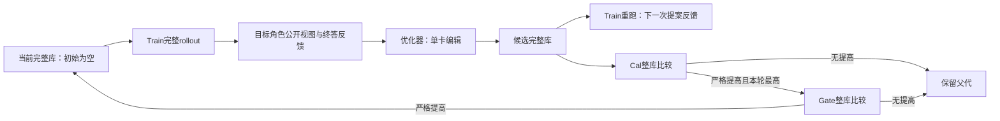

# MVAgent：免训练 Skill 自进化设计

2026-10-21。目标是固定 Actor、Selector、工具与推理预算，仅进化 Global/Video 两个库的卡片文本，提高完整多视频问答的官方总分。本设计把已观察的事实、待验证假设和首版实现分开；不是对旧进化算法的恢复，也不预先保证正收益。

## 1. 现有证据能支持什么

| 证据 | 可以支持的判断 | 不能据此声称 |
|---|---|---|
| 360题三模型配对先导：9B +1.92pp，35B −0.19pp，27B −3.02pp；95%区间均跨0 | 同一份一次生成库没有显示稳定收益，必须实测筛选 | 已证明skill无用，或已证明自进化一定必要/有效 |
| 同库Global非空选择率72.5%/45.6%/87.5%，Video 15.8%/52.6%/94.0% | 路由和模型行为是系统效果的一部分 | 选得多就更好；27B下降必然由某张卡造成 |
| 用户历史观察：E2E正确、MVAgent错误的筛选子集，强制watch后约47%恢复 | 直接联合观看与分解分析可能有互补性，是可复核的机制假设 | 总体可提升47%；当前协议能复现；所有失败都应改用watch |
| 当前48H100补测 | 冻结一次生成库的进一步评估；保持后台运行 | 尚未完成的全量成绩、独立盲测结论 |

先导完整分数、分任务结果、源码与限制见[现有报告](deepseek-skill-pilot.md)。历史47%没有在本轮重新获得可对齐的清单、样本数和冻结配置，暂作为用户提供的观察，不写成已复现结果。已有数据和提示开发不能事后重命名为独立Test。

## 2. 为什么不能直接套用单Prompt优化

Global只有问题、视频ID/时长和公开action history；VideoAgent是instruction→报告的黑盒。Video只看到自己的instruction、时长及同视频跨请求Memory。优化输入必须按角色投影：Global不读Video内部步骤；Video不读Global问题/其他视频/下游私有上下文。题号、task代号、预设题型和答案键均不进入优化Prompt。

选卡是一个先于取证的决策：Global每题选一次，Video每次instruction选一次，均可弃选，随后固定。因此：

- `when_to_use`必须根据问题或instruction即可识别；隐藏的冲突、证据不足和历史观察条件写进`strategy`。
- Actor只收到`strategy`，策略本身必须带必要的适用前提与退出条件。不能依赖下一张卡或Global策略自动传给Video。
- `analyze_videos`适合可局部回答、可通过结构化报告组合的证据；需要共同视觉标尺的细节可能更适合`watch_videos`。后者至少比较两个视频，片段共享单次帧预算，不提供FPS参数。
- Video的`observe`控制what、有序时间范围和计划FPS；每个range单独观察并有各自帧上限。`finish`应依据已获得证据，跨请求记忆意味着不能总从空白开始。
- 最终错误不等于Video局部错误。Global指令不完整、局部报告缺信息、跨视频合成失误和格式偏差都可能产生相同终态。

这些边界决定优化对象必须是**自然选卡下的整库行为**，而不是单卡的离线文字评分或只在它命中的题上测分。

## 3. 调研与取舍

| 方法 | 可借鉴机制 | 在MVAgent中的边界 |
|---|---|---|
| [SkillOpt](https://arxiv.org/html/2605.23904v1) | 从成功/失败轨迹产生有界文本编辑，通过验证反馈保留更新 | 原方法主要优化单份skill文档；我们的路由字段、可弃选和双角色需要额外处理。一次生成对照可保留，不补做人写skill实验 |
| [GEPA](https://arxiv.org/abs/2507.19457) | 反思轨迹，保留互补候选；明确父代与评估预算 | 先用单父代坐标更新建立可靠基线；只有出现“候选互补而贪心停滞”的证据，才增加候选池/Pareto搜索 |
| [SkillAdaptor](https://arxiv.org/abs/2606.01311) | 尝试定位可行动的失败步骤，减少过宽修订 | 不能把LLM定位当因果真相；也不恢复旧adaptor训练器。用角色可见证据和整库干预检验解释 |
| [MASPO](https://arxiv.org/abs/2605.06623) | 多Agent提示之间存在相互依赖 | 一次改一个角色，另一个角色冻结；搭档库改变后重新评估。禁止缓存另一个Agent的旧报告来代替新完整rollout |
| [EvoSkill](https://arxiv.org/abs/2603.02766) | 从失败中发现可复用技能，并验证新候选 | 只允许编辑schema v3卡片，不进化任意文件、工具代码或框架 |
| [Video-RSI](https://arxiv.org/html/2609.37950v1) | 旧轨迹没有观察到某事件，不能区分漏采样与看错；需要额外证据检验解释 | 必要的新证据通过Train完整rollout、冻结工具获取。首版不允许优化器任意看视频/改harness，不采用其成本联合目标 |
| [LensWalk](https://arxiv.org/abs/2603.24558)、[AgentCVR](https://arxiv.org/abs/2605.29643) | 观察位置/采样方式与跨视频协调是重要决策 | 它们作为系统基线，不能替代“同一MVAgent只变skill”的方法对照；AgentCVR的RL不符合本方案免训练约束 |
| [OEO](https://arxiv.org/abs/2608.09629) | 优化器足够强时，固定多阶段流程未必最好；效果依赖优化器能力 | 不预设复杂planner/critic/聚类链条。先固定数据、编辑权限和评价接口，测简单闭环，再比较更自主的提案方式 |

论文机制与当前代码版本不总相同。本地`reference/SURVEY.md`中“旧v2已实现”“逐桶保护”等描述属于历史，不能作为当前实现或新接受规则。首版不加入逐题不退化、调用数、token数或成本接受门。

## 4. 首版闭环：单角色编辑，整库比较

初始状态是两个空库。优化器默认DeepSeek-Flash，Actor先用固定35B-A3B；优化器和Actor权重均不更新。当前是外部优化器驱动的skill进化，不是Actor同时充当Editor的同模型RSI，也不递归改写优化器。每角色最多8张是首轮控制检索混杂的实验约束，不是最优卡数结论。卡数从0自然增长，不要求凑满。

1. 冻结源码、模型/推理配置、Train/Cal/Gate清单及数据身份。运行空库的Train、Cal、Gate完整问答并保存原始rollout，再评分。
2. 按Global→Video轮换。优化器只接收当前目标角色的库、运行契约、Train角色公开轨迹和Train终答得分反馈。Video得分明确标记为整题结果，不标成局部报告正确率。
3. 每次提出一个`add / revise / remove / noop`编辑；一次只动一张卡，另一角色完整冻结。程序分配新ID并校验Schema、1200词、角色归属和编辑范围；禁止记忆题目捷径等语义要求写入Prompt，不宣称程序能自动证明卡片内容合规。输出先落盘，格式失败保留并消耗一次提案预算，不静默删字段或重抽。
4. 候选在同一Train上重新完整运行。对比父代与候选的公开证据、选卡和终答得分，用于下一次提案；不得把不同instruction的两次Video调用强行配成局部因果对照。
5. 每个有效候选都在完整Cal上自然选卡评估。只选官方总分最高且严格高于父代的候选进入Gate；平分保留父代，不用成本或步数破平局。
6. Gate也比较父代与候选整库的完整rollout。只有官方总分严格增加才接受，否则继续当前库。Cal/Gate逐题内容与分数不返回优化器。接受后复用该库已完成的Train结果，不复用旧搭档报告。
7. 保留所有候选、失败、接受/拒绝记录和哈希；预算耗尽输出当前已接受库，可能仍为空库。候选池和复杂合并暂不加入。



Cal/Gate的逐题信息不进入优化器；图中的所有rollout都通过原有Selector自然选卡。

这里的Train前后对照是受控的库级干预，不自动证明某一条观察或某一张卡具有局部因果作用。可见的路由变化、action变化和报告变化用于形成下一假设，接受依据仍是整库总分。

## 5. 评价与数据边界

CrossVid总分为十类task得分的等权macro；CCQA内部按评分点加权。复用`eval/benchmarks/`官方实现，缺某类时不冒称十任务总分。Gate仅接受`score(candidate) > score(parent)`；小样本正差不等于统计显著，最终报告配对差、区间、修复/退化数量及样本量。

- Train：唯一可供优化器读取的逐题轨迹/反馈；不提供task代号、题号、参考答案和Judge评分点。
- Cal：所有候选的固定筛选面板；只由程序读分，不作为优化器例子。
- Gate：正式接受面板；有限次数重复使用，属于开发验证，不是无偏Test。所有Gate尝试必须记账，不把多次尝试后最高分直接当独立泛化证据。
- Test：库冻结后才评估；CVBench/MVU不进入优化循环。鉴于已有系统开发和全量评测历史，必须披露曾有的开发接触；新的严格盲测需要预留未接触数据，不能靠重新命名旧split获得。

首测拟使用CrossVid十任务80 Train / 40 Cal / 40 Gate，seed=0，排除Lite2500及既有144题闭式split的题号，Train/Cal/Gate按共享源视频连通分量隔离。它仍可能与历史开发面板共享视频源，必须报告。元数据准备只验证这项已知泄漏风险是否能满足本次三分区，不以证明所有历史来源全不重叠阻塞首测。清单只在Modal保存；旧清单不重抽或改名。

CCQA沿用固定本地Judge与官方Prompt；同一运行内相同答案使用同一评分缓存。Judge失败报错，原始答案保留，不能记0替代。推理故障与模型正常答错分别记录；有未解决工程故障的整库评估不能直接用于接受。

## 6. 工程划分与复用

```text
src/skill_evolution/
  configs/                 # 模型配置读取、进化参数校验；YAML配方仍在根configs/
  infra/                   # 不含算法选择的库编辑/冻结、角色轨迹投影、模型调用留存、评估接口
  algorithms/
    one_shot/              # 现有一次生成基线，迁移但不改Prompt或产物协议
    rolewise/              # 本设计的提案Prompt、角色轮换、Cal选优与Gate接受
  skill_specification.md

eval/skill_eval/           # 数据/评分/批量执行适配；复用现有agent_eval与benchmarks
scripts/generate_skills.py # 保留已有公开入口
scripts/evolve_skills.py   # 进化入口
configs/skill_evolution/   # 模型和实验YAML；不在Python代码中写密钥
```

依赖方向为`eval适配器 → skill_evolution → mvagent/models`；`src`不能导入`eval`。
只从`de28149`选择性恢复Global/Video公开视图投影思路，增加显式边界校验和必要测试。
旧`infra/store.py`的原子JSON和哈希已在`mvagent.utils.io`，直接复用；旧benchmark/data/scoring能力已在`eval`，不再复制回infra。
原生批量执行已提供原始记录、resume和逐请求日志，不新增第二套调度器、媒体缓存或Judge。

每次评估配置绑定完整库的路径/SHA；空角色关闭skill。缓存键至少包含完整库、split、Actor/推理配置及冻结源码身份。任何一项变化都不能复用旧分数。resume必须从本次冻结源继续，不能给运行中的批次热更新。

## 7. 最小实验和继续条件

首版时间预算：设计/实现先完成一个能产出主指标的闭环；CPU检查与首个小规模真实运行通过后立即进入首测。新增GPU最多16 H100，现有48卡任务保持独立。先申请一个8卡节点（7 Actor＋1 Judge），只有已获得实际吞吐且需要缩短首测时才增加第二个8卡节点。

| 实验 | 回答的问题 | 如何决定下一步 |
|---|---|---|
| 空库→首个Global候选→首个Video候选，至少各一轮 | 整个优化/筛选/接受闭环是否有效运行，新增卡能否自然选中 | 无激活先分析when_to_use与可见输入；有激活无收益检查实际动作/报告；不得用手工强选把失败藏掉 |
| 同题Train父/候选轨迹 | 是路由没变，还是选中后行为没变/变坏 | 报告观察，不直接改Actor；后续有证据再做routing-only/strategy-only消融 |
| 路由与策略分别冻结的修订对照 | 更新两字段是否优于只更新一项 | 在相同rollout预算下比较Cal/Gate；作为方法贡献实验，不先假定结论 |
| 角色单独优化、交替优化与双方一次联合改写 | 分角色更新是否减少相互干扰 | 用相同数据与候选评估预算；报告Global-only、Video-only及联合结果 |
| 自然选择下的watch倾向/分解分析倾向候选 | 历史47%现象在当前协议是否仍有方向性价值 | 先报告恢复率、原正确题退化率与总体净差；若只是选中子集获益，不宣称总体提升 |

具体的方向选择不靠累计候选数量，而靠以下可观察结果：

| 观察 | 下一项最小干预 | 解释边界 |
|---|---|---|
| 卡片在语义相关Train输入上仍反复弃选 | 固定strategy，只改when_to_use，与双字段更新等预算比较 | 不把“强制命中后的成绩”替代真实部署成绩 |
| 选中了卡，但action/观察范围/报告基本不变 | 固定when_to_use，只修订可执行步骤、适用前提和退出条件 | 先确认行为改变；文字变长本身不是有效机制 |
| watch修复原失败题，同时损伤原正确题 | 只根据选择时可见的问题特征收窄入口；需观察后才知道的条件写成strategy内部的检查分支 | 对历史失败筛选子集的修复率必须同时报告回归，不能外推总体收益 |
| Video候选改变后终答变化，但instruction/先前Memory也变了 | 保留整库干预结论；局部分析仅比较相同调用上下文，必要时先做Global-only/Video-only对照 | 不把下游分数硬归因给某个局部观察；不同请求不凑成局部配对 |
| Train或Cal提高，Gate不提高 | 保留父代并记录拒绝；后续扩大开发源组覆盖、检查案例记忆，保持接受规则不变 | 不降低Gate阈值或换一批有利题目来“证明成功” |
| 不同候选修复互补题目，单父代更新反复停滞 | 再评估GEPA式候选池/合并，仍以完整库自然选择检验干扰 | 互补性只是在Train上提出假设，不能用Gate逐题结果指导合并 |

首轮即使没有候选通过Gate也保留完整负结果，不临时换面板、减小接受阈值或偷偷重写卡片。小面板只决定工程与研究方向，不能支撑顶会主结论。

## 8. 论文实验最低配置

主表至少包含同一冻结MVAgent的空库、无反馈LLM一次生成、Train轨迹一次蒸馏、迭代优化；另保留E2E及现有视频Agent系统对照。按用户决定不做人写skill对照，说明这一缺项。

算法对照优先适配SkillOpt式单文档/单卡更新与GEPA式反思搜索，尽量统一优化器、Train/Cal/Gate、Actor、候选rollout预算和部署方式；不把改变基础System的强基线与仅改skill的结果混称同一干预。无法完全等预算时同时报告优化器token、Actor问答次数和GPU小时，它们是审计量，不进入接受目标。

必须分开验证：反馈与迭代收益、选卡字段收益、角色交互、空库与一次生成初始化、拒绝机制、模型间迁移、随机split稳定性和优化曲线。若使用“自改进/RSI”主张，还需对照外部强优化器与Actor自身作为Editor，避免把更强优化器的能力误称为同模型递归改进。多seed主要改变数据抽样/搜索，不擅自改变已冻结的推理seed=0。卡数/字数匹配用于排除“只是更长”的解释。

当前“角色隔离＋整库验证”的闭环首先是必要的工程基线，本身还不足以宣称新的顶会算法贡献。值得检验的研究点是：**只有角色可见信息、选卡可弃选、局部回报不可直接归因的条件下，如何用同题完整rollout的反事实反馈学到可迁移的取证策略。** 如果这些消融不能成立，应收缩论文主张，而不是继续堆叠模块。

## 9. 实施与实测状态

本节随本轮实现和Modal验证更新。角色轮换闭环与评估适配已实现；真实首测已启动，下面的CPU检查与服务加载不等于精度实验完成。

- Modal CPU `ap-98t3dr48qeAVDTQdYMnWHb` 完成十任务80/40/40清单，seed=0，三分区源组互斥；排除2644个既有题号，完整9015题有772个声明源连通分量。
- 160题中142题与被排除的历史面板共享源组，故明确为开发实验；题号排除不等于历史来源全隔离。
- 清单与审计在runs `devbox/skill_evolution_20261021/{split,split_audit}.json`，清单SHA256 `11bf8151779729b39b495b4d9c3a439b6924108b1a0d893ad39de530cdf9baeb`。数据准备没有Actor/Judge调用。
- 设计中的扩展消融尚未实施。

- 当前实现包含单卡/单角色编辑、双空库初始化、完整Train反馈、Cal筛选/Gate接受、API响应留存、冻结源码恢复及固定Judge适配；没有候选池、跨角色联合修改或额外视频调查器。
- Modal CPU累计22个不同回归用例通过（一次生成9、进化9、评估适配2、冻结恢复2），完整compileall与两个CLI检查通过；额外逐字比较确认迁移前后一次生成System/User/Schema不变。
- 补充测试曾在无Git的CPU镜像中失败；已支持只有源码归档的环境，正式运行仍显式记录来源commit，失败日志保留。缓存身份新增CrossVid标注哈希，长轨迹对父/候选分别保留首尾，反馈得分不会被截断。
- 首个真实接入实验从上述160题清单各分区每task取首个样本，得到10 Train / 10 Cal / 10 Gate；不重抽、不破坏三分区源组隔离。两轮Global→Video，每轮最多2候选，最多130个完整问答，额外8H100（7 Actor＋1 Judge）。这只是闭环接入实验，每类仅1题，不用它估计稳定提升或置信区间。
- 新划分排除了此前全量面板的题号，故需要测其空库起点；不是重复后台那批已有的完整空库对照。正式80/40/40面板保留，是否扩大运行依据接入结果和剩余预算决定。

- 10:17 UTC：独立8H100 Sandbox `sb-drCh0QrzwZs7zMRfvcA8sx`，来源commit `1d7928e`；7个固定Actor端点已就绪，Judge加载中。首测分区清单SHA `85f56ba07892c689e71382e6ae09d92769ad945680782ec004a0f1a650a1978f`，结果只保存在runs `devbox/skill_evolution_20261021/probe/`。尚无新闭环成绩；原48H100测试持续运行。

- 10:30 UTC：空库30题完成，Train/Cal/Gate十任务macro为50.00%/30.00%/40.00%，各10题。首个Global提案15.89秒完成，结构有效，候选SHA `821e7e249b182d83c806a03e81bfd09a4eda27beaad35476f30e19b6fd6ce174`，开始真实Train重跑。它提出更针对性的联合观察/证据核对，但`when_to_use`包含选择时不可见的History条件，属于已观察的语义缺陷，结构校验不能排除。保持原候选测量，不手工修卡；是否增加可见性约束消融，依据其选卡、行为与Cal/Gate反馈判断。
